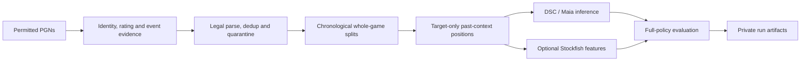

# Farzin Opponent Intelligence (FOI v1)

FOI v1 is a reproducible research pipeline for evaluating next-move prediction on carefully verified professional chess games. It parses PGNs, resolves players only from configured FIDE IDs and verified aliases, checks historical ratings and per-game provenance, extracts target-player decisions with past-only context, and evaluates complete legal-move policies.

This repository contains code and procedures, not a public player dataset or a trained FOI model. Real-player data, derived positions, predictions and Kaggle inputs remain private unless their redistribution rights have been established. No accuracy claim is made here. The existing local experiments include GPU model smoke runs on synthetic positions; they are not player benchmarks (see [verified local run summary](reports/public/VERIFICATION.md)).

## What is included

- PGN validation, identity/rating resolution, deduplication, chronology-aware splits and target-only position extraction (`foi_pipeline/`).
- Full-policy ranking and evaluation with game-level bootstrap intervals (`foi_pipeline/evaluation.py`).
- DSC and Maia Kaggle inference entry points (`kaggle/`, `kaggle_benchmark/`). They download upstream software and weights at run time; none are bundled.
- Synthetic unit tests and configuration templates. No real-player PGN or model weights are included.

## Quick start (CPU)

Python 3.10 or later is required. From a clean checkout:

```bash
python -m venv .venv
source .venv/bin/activate
python -m pip install -r requirements.txt
python -m unittest discover -s tests -p 'test_*.py'
```

The tests use generated synthetic PGNs and do not contact Kaggle or download models. A minimal dataset validation command is:

```bash
python scripts/validate_dataset.py \
  --players configs/players.yaml \
  --ratings configs/ratings.csv \
  --reviews configs/game_reviews.csv \
  --source-manifest configs/source_manifest.csv \
  --output-dir data/validated
```

Copy the relevant `*.example.*` templates in `configs/` to the names in the command, then fill them only with identities and source material you are authorized to process. The output is private research data: keep it outside source control. Full options and manual PGN invocation are in the [benchmark runbook](docs/FOI_BENCHMARK_RUNBOOK.md).

For example, create private config files with:

```bash
cp configs/players.example.yaml configs/players.yaml
cp configs/ratings.example.csv configs/ratings.csv
cp configs/source_manifest.example.csv configs/source_manifest.csv
cp configs/game_reviews.example.csv configs/game_reviews.csv
```

These local filenames are ignored by Git.

## Pipeline



See [architecture](docs/ARCHITECTURE.md), [dataset protocol](docs/DATASET_PROTOCOL.md), and [evaluation contract](docs/EVALUATION.md).

## Model and Kaggle workflow

The optional GPU kernels are for inference only. DSC-150M is the primary model and Maia 3 79M is a comparison. Their weights and Python packages are fetched from upstream at run time. The smoke kernel exercises a synthetic position; the benchmark kernel accepts a separately attached private dataset and must remain private. See [Kaggle and model setup](docs/MODELS_AND_KAGGLE.md).

Kaggle CLI setup uses your existing local login; never put Kaggle credentials in this repository. Generate metadata with a public Kaggle username:

```bash
python scripts/configure_kaggle.py --username YOUR_KAGGLE_USERNAME
kaggle kernels push -p kaggle
```

The generator marks the kernel private and enables GPU and internet. Review metadata before submitting. A real-player benchmark workflow and private output handling are documented in the runbook.

## Research safeguards and limitations

- Require verified player identity, FIDE monthly standard ratings at game date, classical time-control evidence, OTB evidence, legal moves and source provenance. Missing/ambiguous evidence is quarantined.
- Split by complete game chronologically (and by event when that is the reliable grouping unit); never split positions from one game across partitions.
- Historical holdouts can overlap a model's pretraining corpus. Call them retrospective and do not imply the model had not seen those games.
- DSC exposes a distribution over legal moves. Maia UCI MultiPV output alone is top-k only; do not use it as a full policy or calculate full-policy NLL from truncated candidates. The included benchmark adapter uses pinned Maia Python internals and therefore needs version-specific verification.
- Stockfish is an optional fixed-budget analysis feature source, not a human move-probability baseline. Any binary must be installed separately and its license/attribution obligations followed.
- A one-ply score with the game's preceding moves is conditional next-move prediction, not a forecast of an entire game or a psychological assessment.
- No fine-tuning is performed by these scripts; personalization is disabled in the supplied benchmark kernel.

## Verification

```bash
python -m unittest discover -s tests -p 'test_*.py'
python scripts/publication_safety.py
```

GitHub Actions runs the same CPU-only tests, Ruff linting, and publication safety check. CI does not use GPU, Kaggle credentials, or player data.

## Licensing and attribution

FOI has no blanket license file; no license has been selected for the original project code. Public visibility does not grant permission to reuse it. Third-party components remain separate: DSC is GPL-3.0, Maia 3 is AGPL-3.0, Stockfish is GPL-3.0, and python-chess is GPL-3.0-or-later. The repository contains no upstream model source or weights. See [third-party notices and scope](docs/THIRD_PARTY_NOTICES.md). Review upstream terms and applicable obligations before combining or distributing software.

## Contributing and security

Read [CONTRIBUTING.md](CONTRIBUTING.md), [AGENTS.md](AGENTS.md), [publication policy](docs/PUBLICATION_POLICY.md), and [SECURITY.md](SECURITY.md). Never submit credentials, raw/derived real-player data, model weights, or private run output.
